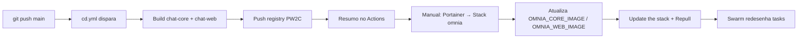

# Processo de Migração — Oracle Cloud VM → PW2C Docker Swarm

**Data:** 2026-10-19
**Branch:** `feat/deploy-pw2c-swarm` → `develop`
**Merge final:** `47540cd` → `develop`
**PR para main:** pendente

---

## 1. Contexto

O projeto rodava em uma VM gratuita da Oracle Cloud (`167.126.20.64`) com deploy via SSH + `docker compose`. A instância travou em estado `Stopping` com o console reportando `Running` — nenhuma transição respondia, todas as portas fechadas, audit log sem registro de tentativas. A empresa ofereceu o cluster Docker Swarm gerenciado pelo Portainer (Community Edition) como alternativa.

---

## 2. Decisões arquiteturais

| #   | Decisão                            | Motivo                                               |
| --- | ---------------------------------- | ---------------------------------------------------- |
| 1   | API do Portainer em vez de webhook | Webhook de stack é Business Edition; CE devolve 404  |
| 2   | `PUT` reenvia compose inteiro      | PUT substitui; corpo vazio apaga a stack sem erro    |
| 3   | `.Env` da stack vai inteiro        | Senha do Postgres vive no `.Env`, não no compose     |
| 4   | Postgres preso ao `compute01`      | Volume local; banco que muda de nó sobe vazio        |
| 5   | `replicas: 1` no Core              | Migration roda no start; 2 tasks = colisão de schema |
| 6   | Migration no `entrypoint.sh`       | Swarm: serviço perpétuo + sem `depends_on`           |
| 7   | Sem healthcheck na stack           | Quem conta é o `HEALTHCHECK` da imagem               |
| 8   | Senha como variável com `:?`       | Uma fonte só; Swarm recusa stack se faltar           |
| 9   | `platforms: linux/amd64`           | Cluster é amd64                                      |
| 10  | Cache GHA `mode=max`               | `npm ci` é etapa lenta                               |
| 11  | Três tags por imagem               | Branch=deploy, sha=rollback, latest=inspeção         |
| 12  | Comentários → documentação         | Comentários que explicam decisão envelhecem mal      |

---

## 3. Mudança de modelo

| Aspecto            | Antes (Oracle VM)                | Agora (PW2C Swarm)                      |
| ------------------ | -------------------------------- | --------------------------------------- |
| **Registry**       | `ghcr.io`                        | `registry.cloud.grupopw2c.com.br`       |
| **Credencial**     | `GITHUB_TOKEN` (auto)            | `PW2C_REGISTRY_PASSWORD` (manual)       |
| **Entrada deploy** | SSH + `scp` + `deploy.sh`        | API Portainer (GET → modifica → PUT)    |
| **Topologia**      | `docker compose`                 | `docker stack`                          |
| **Postgres**       | Fora, rede `omnia-db` + alias    | **Serviço da stack**, volume local      |
| **Rede**           | `omnia-db` externa               | `omnia_net` overlay do Swarm            |
| **Migration**      | Serviço `migrate-core` (termina) | No `entrypoint.sh` (Core sobe depois)   |
| **Fixidez banco**  | Implícita (1 VM)                 | Constraint `node.hostname == compute01` |
| **Trigger CD**     | `workflow_run` após CI           | `push` direto em `main`                 |
| **Secrets**        | 3 (SSH)                          | 6 (2 registry + 4 Portainer)            |

---

## 4. Arquivos criados

| Caminho                                    | Descrição                               |
| ------------------------------------------ | --------------------------------------- |
| `apps/docker/pw2c/docker-stack.yml`        | Stack Swarm (postgres, core, web)       |
| `apps/docker/pw2c/stack.env.example`       | Template variáveis da stack             |
| `apps/docker/entrypoint.sh`                | Espera PG → migration → server          |
| `apps/docker/Dockerfile.core`              | + `postgresql-client` + `entrypoint.sh` |
| `.github/workflows/cd.yml`                 | Build + push (sem deploy da stack)      |
| `docs/ci_cd/decisoes.md`                   | 12 decisões arquiteturais               |
| `docs/ci_cd/troca-de-servidor/README.md`   | Por que mudou, 4 diferenças-chave       |
| `docs/ci_cd/troca-de-servidor/migracao.md` | Mudança por mudança (antes/depois)      |
| `docs/changelog/CHANGELOG.md`              | Changelog completo                      |
| `docs/changelog/REMOCAO_COMENTARIOS.md`    | ~223 linhas de comentários removidas    |

---

## 5. Arquivos removidos

| Arquivo                                 | Motivo                        |
| --------------------------------------- | ----------------------------- |
| `.github/workflows/cd.yml` (antigo)     | Pipeline SSH + VM Oracle      |
| `apps/docker/deploy.sh`                 | Script SSH da VM              |
| `apps/docker/docker-compose.deploy.yml` | Compose da VM                 |
| `apps/docker/.env.homolog`              | Não existe mais homolog na VM |
| `apps/docker/.env.prod`                 | Não existe mais prod na VM    |

---

## 6. Arquivos modificados (destaques)

| Arquivo                              | Mudança principal                                |
| ------------------------------------ | ------------------------------------------------ |
| `apps/docker/Dockerfile.core`        | + `postgresql-client`; + `COPY entrypoint.sh`    |
| `apps/docker/pw2c/docker-stack.yml`  | Stack Swarm (postgres, core, web)                |
| `apps/docker/pw2c/stack.env.example` | Template variáveis (sem secrets)                 |
| `.github/workflows/cd.yml`           | Build + push apenas; sem deploy                  |
| `apps/docker/entrypoint.sh`          | Novo: espera PG → migration → server             |
| `apps/chat-omnia/README.md`          | Registry PW2C + porta do cluster                 |
| `README.md` (raiz)                   | Aponta para cluster PW2C                         |
| `docs/estrutura/ambientes.md`        | Reescrito: dev + cluster (sem .env homolog/prod) |
| `docs/estrutura/config_github.md`    | Secrets registry PW2C + Portainer                |
| `docs/estrutura/docker.md`           | Stack Swarm no lugar do compose                  |
| `docs/estrutura/README.md`           | Aponta para cluster                              |
| `docs/ci_cd/*.md`                    | 8 docs reescritos para Swarm                     |

---

## 7. Remoção de comentários

Commit `5846d80` removeu ~223 linhas de comentários de 4 arquivos:

| Arquivo            | Antes | Depois | Removidos |
| ------------------ | ----- | ------ | --------- |
| `docker-stack.yml` | 148   | 78     | 70        |
| `cd.yml`           | 247   | 169    | 78        |
| `Dockerfile.core`  | 72    | 26     | 46        |
| `entrypoint.sh`    | 52    | 23     | 29        |

**Princípio:** comentário que explica decisão → documentação (`docs/ci_cd/decisoes.md`). Comentário que explica código → removeu.

---

## 8. Mudanças no código (além da infra)

### `Dockerfile.core`

- Adicionado `RUN apk add --no-cache postgresql-client` (resolve `pg_isready: not found`)
- `COPY apps/docker/entrypoint.sh /entrypoint.sh`
- `ENTRYPOINT ["/bin/sh", "/entrypoint.sh"]`

### `entrypoint.sh` (novo)

```sh
# Espera Postgres responder
until pg_isready -h "${PG_HOST}" -p "${PG_PORT}" -q; do sleep 2; done
# Aplica migrations
node dist/db/migrate.js
# Sobe servidor
exec node dist/index.js
```

### `docker-stack.yml` (stack Swarm)

- Postgres como serviço com constraint `node.hostname == compute01`
- Core com `replicas: 1` (migration no start)
- Web com `mode: host` na porta `OMNIA_WEB_PORT`
- Secrets removidos → variáveis `.Env` com `:?`

### `.github/workflows/cd.yml` (novo)

- Job único: `build-and-push`
- Só build + push das 2 imagens (3 tags cada)
- Sem deploy automático da stack
- Resumo orienta atualização manual no Portainer

---

## 9. Checklist para deploy funcionar

### No Portainer

- [ ] Stack `omnia` criada (Web editor → cole `docker-stack.yml` → Deploy)
- [ ] Environment variables preenchidas:
  - `OMNIA_CORE_IMAGE=registry.cloud.grupopw2c.com.br/chat-core:latest`
  - `OMNIA_WEB_IMAGE=registry.cloud.grupopw2c.com.br/chat-web:latest`
  - `OMNIA_WEB_PORT=8080`
  - `POSTGRES_DB=omnia`
  - `POSTGRES_USER=omnia_user`
  - `POSTGRES_PASSWORD=<senha_real>`
  - `AI_PROVIDER=echo`
  - `NVIDIA_API_KEY=` (vazio)
  - `NVIDIA_MODEL=meta/llama-3.3-70b-instruct`
  - `NVIDIA_BASE_URL=https://integrate.api.nvidia.com/v1`
  - `NVIDIA_TIMEOUT_MS=300000`
  - `NVIDIA_MAX_TOKENS=400`

### No GitHub (Settings → Secrets → Actions)

- `PW2C_REGISTRY_USERNAME`
- `PW2C_REGISTRY_PASSWORD`
- `PORTAINER_URL` (ex: `https://portainer.empresa.com.br`)
- `PORTAINER_API_KEY` (token com escopo de escrita em stacks)
- `PORTAINER_STACK_ID` (id da stack `omnia` na URL)
- `PORTAINER_ENDPOINT_ID` (geralmente `1`)

### No cluster (compute01)

- Label do nó confirmado: `docker node ls` → `compute01` existe
- Se precisar mudar: `docker node update --label-add omnia_db=true <novo-no>` + ajuste na constraint

---

## 10. Fluxo de deploy (pós-merge para main)



**O CD não atualiza a stack automaticamente.** O workflow termina com instruções para atualização manual no Portainer.

---

## 11. Rollback

Não há botão de rollback no Portainer. Para reverter:

```
1. Stacks → omnia → Environment variables
2. OMNIA_CORE_IMAGE = registry.../chat-core:<sha-antigo>
   OMNIA_WEB_IMAGE  = registry.../chat-web:<sha-antigo>
3. Update the stack + Re-pull image
```

Só reverte código. Migration já aplicada não volta (Drizzle não tem `down`). Se schema novo quebrar versão antiga, restaure o volume do Postgres.

---

## 12. Problemas conhecidos e soluções

| Sintoma                                     | Causa                              | Solução                                    |
| ------------------------------------------- | ---------------------------------- | ------------------------------------------ |
| `manifest unknown`                          | Imagem não publicada               | Merge para main dispara CD                 |
| `unauthorized` no pull                      | Credencial divergente              | Conferir secrets GitHub = cluster          |
| `no matching manifest linux/amd64`          | Build sem platform                 | `platforms: linux/amd64` no workflow       |
| `web` 502                                   | Core não subiu                     | `docker service logs omnia_core`           |
| `constraint requirements not satisfied`     | Nó `compute01` não existe          | `docker node ls` + ajuste constraint       |
| `relation "conversations" does not exist`   | Postgres em nó errado              | `docker service ps omnia_postgres`         |
| `core` reiniciando                          | Banco fora ou senha errada         | Log do Core + conferir `POSTGRES_PASSWORD` |
| `postgres nao respondeu apos 30 tentativas` | Core não acha banco                | `docker service inspect omnia_core` redes  |
| Workflow verde mas app não mudou            | `OMNIA_CORE_IMAGE` ausente no .Env | Adicionar no Portainer                     |

---

## 13. Rollback do processo (se necessário)

Se a migração der errado e precisar voltar para a VM Oracle:

1. `git checkout main` (antes do merge)
2. Secrets antigos: `DEPLOY_SSH_KEY`, `DEPLOY_HOST`, `DEPLOY_USER`
3. `cd.yml` antigo (restaurar do histórico)
4. VM Oracle funcional (se ainda existir)

> **Nota:** A VM Oracle estava presa em `Stopping`. Se não for recuperável, a migração é irreversível sem recriar a VM.

---

## 14. Referências

| Documento              | Link                                    |
| ---------------------- | --------------------------------------- |
| Changelog completo     | `docs/changelog/CHANGELOG.md`           |
| Remoção de comentários | `docs/changelog/REMOCAO_COMENTARIOS.md` |
| Decisões arquiteturais | `docs/ci_cd/decisoes.md`                |
| Troca de servidor      | `docs/ci_cd/troca-de-servidor/`         |
| Stack Swarm            | `apps/docker/pw2c/docker-stack.yml`     |
| Workflow CD            | `.github/workflows/cd.yml`              |
| Stack env example      | `apps/docker/pw2c/stack.env.example`    |
