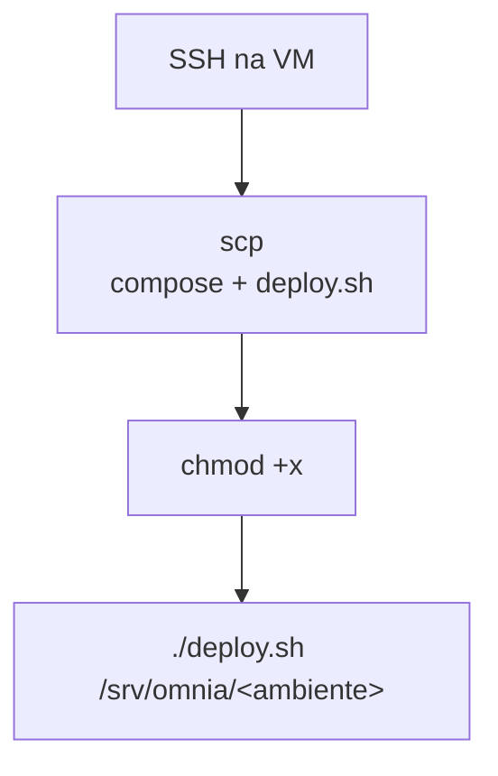
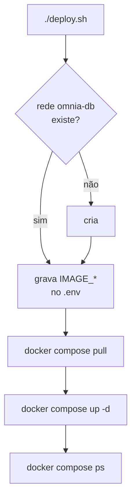
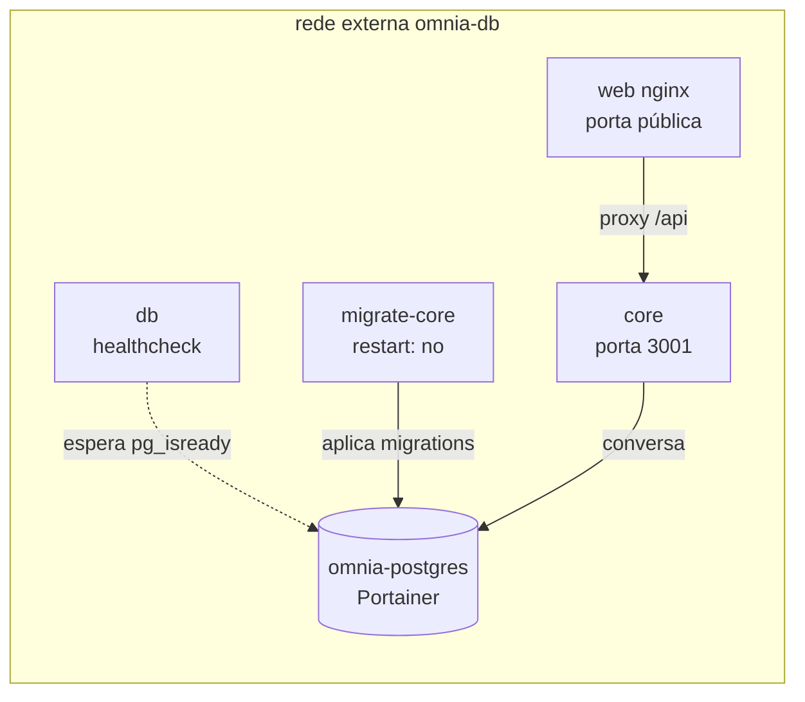
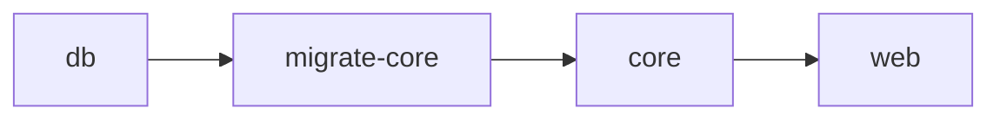
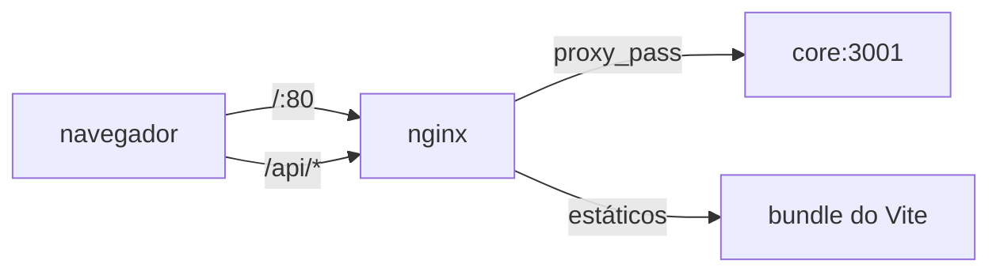

# Deploy

O que acontece na VM depois que a imagem está publicada.

## Entrada pela VM

O job de deploy faz duas operações, em ordem:



Enviar os arquivos a cada deploy, em vez de copiar uma vez e deixar na máquina,
faz o repositório ser a fonte da verdade: uma cópia parada na VM é um compose
diferente do código, e o primeiro sintoma é um deploy que executa a configuração
antiga.

O `scp` precisa de dois ajustes:

```yaml
source: apps/docker/docker-compose.deploy.yml,apps/docker/deploy.sh
strip_components: 2
```

`source` em uma linha, separada por vírgula. Em bloco com quebra de linha, o
item final vazio faz o `tar` sair sem arquivo.

`strip_components: 2` remove os dois primeiros níveis do caminho, para o arquivo
cair na raiz do diretório do ambiente em vez de `apps/docker/`. Sem isso, o
`deploy.sh` executado continua sendo a cópia antiga.

## O que o deploy.sh faz



### A tag vai para dentro do `.env`

O script reescreve só as linhas `IMAGE_*`. O resto — senha, porta, provider —
fica intacto.

Isso porque `docker compose up -d` sem `--pull` **reusa a imagem que já está na
máquina**. Passar a tag por variável resolveria o `pull`, mas deixaria o `.env`
descrevendo uma versão que não é a que está rodando, e o próximo `up` manual
voltaria para a tag antiga sem ninguém perceber.

### `pull` antes de `up`

Sem o `pull`, o compose reusa a imagem local e o código novo nunca chega.

## Os serviços



| Serviço        | Função                               | Porta         |
| -------------- | ------------------------------------ | ------------- |
| `db`           | espera o Postgres responder e sai    | —             |
| `migrate-core` | aplica as migrations e sai           | —             |
| `core`         | a API                                | interna       |
| `web`          | nginx, serve a interface e faz proxy | `${WEB_PORT}` |

O Postgres **não** é deste compose. Já existe na VM e é gerenciado pelo
Portainer.

### A ordem de subida



Garantida por `service_completed_successfully`. `db` e `migrate-core` têm
`restart: 'no'` porque **terminam** — e um container que termina nunca fica
`healthy`, então esperar por `service_healthy` seria uma espera que nunca
satisfaz.

### O serviço `db`

Só um healthcheck: espera o `pg_isready` passar e sai com código 0. Não gerencia
o container do banco, que é de outro stack.

## O banco e as migrations

As migrations do Core ficam em `drizzle_core.__drizzle_migrations`, separadas do
padrão `drizzle` que o pacote `knowledge` usa.

Os dois pacotes apontam para o mesmo banco. Se compartilhassem a tabela de
controle, o migrator do Core leria o carimbo do `knowledge` e concluiria que uma
migration própria — mais antiga que aquele carimbo — já tinha sido aplicada, e a
pularia. A migration seguinte rodaria em cima de um banco sem as tabelas que ela
precisa.

O mesmo schema precisa estar no `drizzle.config.ts`, para o
`npm run db:migrate` do desenvolvimento gravar onde o container grava.

## O nginx



Três decisões:

**Timeout de 330s.** O provider de IA tem teto de 5 min. O proxy precisa ficar
no mesmo patamar, senão vira o gargalo e corta a resposta no meio.

**`proxy_buffering off`.** Sem isso o nginx segura a resposta até completar o
buffer, e o streaming não acontece.

**`index.html` com `no-cache`.** É ele que aponta para os assets com hash.
Cacheado, a interface continua servindo a versão anterior depois de um deploy.

### Por que a API não é publicada

O Core confia no header cru `X-User-Id`: qualquer cliente pode enviar o que
quiser e impersonar outro usuário. Por isso o compose publica **só** a interface.

Num ambiente com usuários reais, um proxy na frente do Core precisa validar um
token e reescrever o header com o subject autenticado.

## Os dois ambientes

|             | Homologação          | Produção          |
| ----------- | -------------------- | ----------------- |
| Diretório   | `/srv/omnia/homolog` | `/srv/omnia/prod` |
| Porta       | `8080`               | `80`              |
| Environment | `homolog`            | `production`      |
| Quando      | branch `develop`     | branch `main`     |
| Aprovação   | nenhuma              | merge na `main`   |

## Documentos relacionados

| Documento                              | Assunto                           |
| -------------------------------------- | --------------------------------- |
| [publicacao.md](publicacao.md)         | build e publicação                |
| [operacao.md](operacao.md)             | verificar, diagnosticar, reverter |
| [pre-requisitos.md](pre-requisitos.md) | o que precisa existir antes       |
