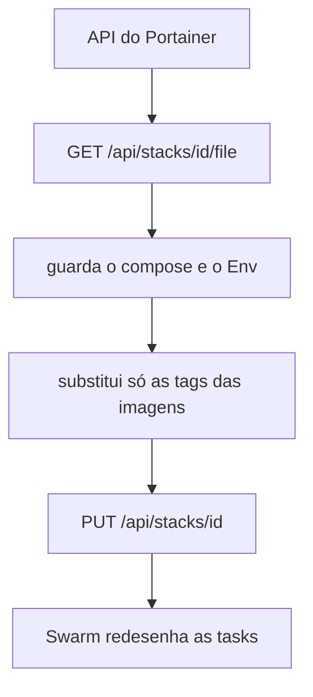
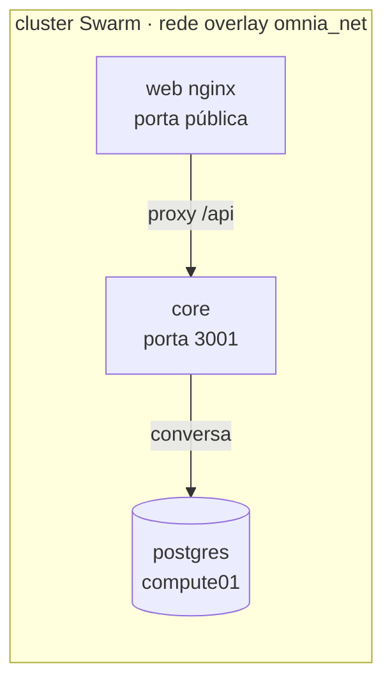
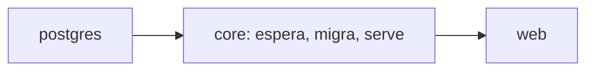
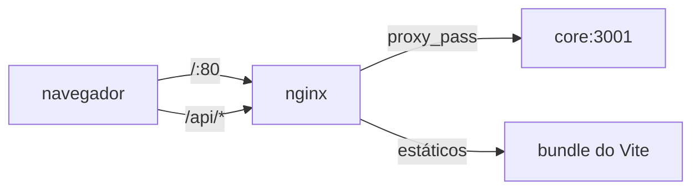

# Deploy (referência da stack)

Este documento descreve a arquitetura da stack Swarm. Para o fluxo atual de publicação e redeploy, consulte [visão geral da CI/CD](visao-geral.md) e [ativação e operação](ativacao-e-operacao.md).

> **Estado do deploy:** após uma CI bem-sucedida em `main`, o CD publica as imagens. Com `DEPLOY_ENABLED=true`, aciona os webhooks Portainer dos serviços `core` e `web`. Isso redeploya os serviços; não altera o arquivo/configuração da stack.

> **Nota histórica:** o procedimento abaixo descreve uma proposta anterior baseada na API do Portainer e não é implementado pelo workflow atual. Use as instruções de [publicação](publicacao.md) e [ativação e operação](ativacao-e-operacao.md) para o fluxo vigente.

## Entrada pela API do Portainer



O Portainer **Community Edition** não tem webhook de stack — é Business Edition.
Por isso o deploy usa a API, que existe nas duas edições.

### Por que o `PUT` reenvia o compose inteiro

O `PUT` **substitui**, não faz merge. Se o corpo vier sem `StackFileContent`, o
Swarm entende que a stack não tem serviços e **remove tudo** — sem erro.

Por isso o deploy primeiro lê o estado atual, mexe só nas duas tags, e devolve
tudo:

```
GET  →  compose atual + Env atual
          ↓ troca OMNIA_CORE_IMAGE e OMNIA_WEB_IMAGE
PUT  →  compose inteiro + Env inteiro
```

O workflow valida que o `StackFileContent` não veio vazio antes de mandar. Um
compose vazio nesse `PUT` passaria o deploy como verde e apagaria a stack.

### Por que o `Env` inteiro vai junto

O `.Env` da stack guarda o que o compose **não** guarda: a senha do Postgres, a
chave da Nvidia, a porta. Os valores vivem lá, não no arquivo.

Se o `PUT` mandasse só as duas tags, o Postgres subiria **sem senha** — e o
sintoma seria confuso: banco criado, Backend conecta, migration roda, e nenhuma
requisição passa.

## Os serviços



| Serviço    | Função                                 | Onde roda   |
| ---------- | -------------------------------------- | ----------- |
| `postgres` | o banco, com pgvector                  | compute01   |
| `core`     | a API, as migrations e o servidor HTTP | `compute01` |
| `web`      | nginx, serve a interface e faz proxy   | `compute01` |

### O Postgres está na stack

No modelo anterior, o compose não tinha serviço `postgres`: o banco vivia fora,
gerenciado pelo Portainer numa rede externa. Aqui a stack é dona do banco.

Isso elimina a necessidade de criar a rede `omnia-db` e conectar o Postgres
com `--alias` à mão. O Swarm resolve `postgres` pelo DNS da rede overlay.

### A ordem de subida



**O Swarm não implementa `depends_on`.** Quem espera é o `entrypoint.sh` do Backend,
que faz três coisas em ordem:

```
1. lê a senha do secret e monta a URL
2. espera o Postgres responder (pg_isready)
3. roda node dist/db/migrate.js
4. exec node dist/index.js
```

Se o Postgres não responder em 60 segundos, o container sai com erro e o
`restart_policy` faz o Swarm tentar de novo.

### Por que a migration é dentro do Backend

No compose, `migrate-core` era um serviço à parte com `restart: 'no'`: rodava,
aplicava, terminava, e o Backend subia depois.

**No Swarm todo serviço é perpétuo.** Não existe container que termina. Um serviço
de migration sairia com o Swarm recriando em laço, e o Backend esperaria um
`service_completed_successfully` que nunca aconteceria.

Por isso `replicas: 1` no Backend é obrigatório: duas tasks subindo juntas
rodariam a migration ao mesmo tempo.

### Por que o Postgres fica preso a um nó

O volume `omnia_postgres_data` é local — não viaja entre servidores. Se o
container mudar de nó, sobe lá um banco vazio, e o Backend conecta num banco sem as
tabas.

O sintoma é o mesmo de migration não aplicada: `relation "conversations" does
not exist`. A diferença é que a migration **roda e reporta sucesso** — ela cria
o schema no banco errado.

A constraint resolve:

```yaml
placement:
  constraints:
    - node.hostname == compute01
```

## O nginx



Três decisões:

**Timeout de 330s.** O provider de IA tem teto de 5 min. O proxy precisa ficar
no mesmo patamar, senão vira o gargalo e corta a resposta no meio.

**`proxy_buffering off`.** Sem isso o nginx segura a resposta até completar o
buffer, e o streaming não acontece.

**`index.html` com `no-cache`.** É ele que aponta para os assets com hash.
Cacheado, a interface continua servindo a versão anterior depois de um deploy.

### Por que a API não é publicada

O Backend valida JWT Bearer com a configuração OIDC (`OIDC_ISSUER`,
`OIDC_AUDIENCE`, `OIDC_JWKS_URL`) e deriva o usuário do `sub`. Os headers
`X-User-Id` enviados pelo cliente são ignorados. A stack publica **só** a
interface; a UI ainda precisa ser integrada ao provedor para obter tokens.

## O banco e as migrations

As migrations do Backend ficam em `drizzle_core.__drizzle_migrations`, separadas do
padrão `drizzle` que o pacote `knowledge` usa.

Os dois pacotes apontam para o mesmo banco. Se compartilhassem a tabela de
controle, o migrator do Backend leria o carimbo do `knowledge` e concluiria que uma
migration própria — mais antiga que aquele carimbo — já tinha sido aplicada, e a
pularia.

O mesmo schema precisa estar no `drizzle.config.ts`, para o `npm run db:migrate`
do desenvolvimento gravar onde o container grava.

## Branches

| Branch    | O que acontece                                    |
| --------- | ------------------------------------------------- |
| `develop` | constrói e publica as imagens com a tag `develop` |
| `main`    | publica e atualiza a stack                        |

Rollback não é um botão no Portainer: aponte `OMNIA_CORE_IMAGE` e
`OMNIA_WEB_IMAGE` no `.Env` para o sha de um deploy anterior e atualize a stack.

## Documentos relacionados

| Documento                              | Assunto                           |
| -------------------------------------- | --------------------------------- |
| [publicacao.md](publicacao.md)         | build e publicação                |
| [operacao.md](operacao.md)             | verificar, diagnosticar, reverter |
| [pre-requisitos.md](pre-requisitos.md) | o que precisa existir antes       |
