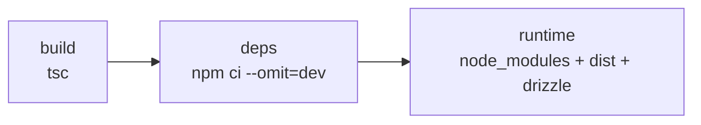
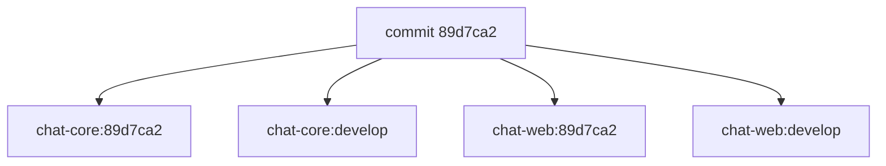

# Publicação

Como o código vira imagem no `ghcr.io`.

## As imagens

| Dockerfile             | Imagem           | O que contém                     |
| ---------------------- | ---------------- | -------------------------------- |
| `Dockerfile.core`      | `chat-core`      | API Hono + migrations            |
| `Dockerfile.web`       | `chat-web`       | nginx servindo o bundle do Vite  |
| `Dockerfile.knowledge` | `chat-knowledge` | migrations do pacote `knowledge` |

### Dockerfile.core

Três etapas: `build` compila o TypeScript com o `devDependencies` inteiro; `deps`
instala só as dependências de produção; `runtime` junta as duas.



Roda como usuário `node` (não-root), expõe 3001, e tem healthcheck em `/`.

A pasta `drizzle/` vai para a imagem porque o deploy aplica as migrations num
container separado, antes do Core subir.

O healthcheck confere o **código HTTP**, não o corpo. `/` responde `200` com
`"degraded"` quando o Postgres está fora do ar — derrubar o Core por causa do
banco trocaria uma degradação visível por indisponibilidade total.

### Dockerfile.web

Duas etapas: build do Vite, depois nginx com os arquivos estáticos. O nginx
também faz proxy de `/api` para o Core.

`VITE_CORE_URL` é **argumento de build**, não variável de runtime: o Vite
embute o valor no bundle durante a compilação.

## O registry

`ghcr.io`, o registry do GitHub. Herda a visibilidade do repositório — e como o
repositório é privado, **as imagens são privadas**.

### Autenticação no workflow

```yaml
permissions:
  packages: write
```

O `GITHUB_TOKEN` é automático: não se cria nada, ele já existe no runner.

### Autenticação na VM

A VM precisa de credencial própria para o `pull`. Ver
[pre-requisitos.md](pre-requisitos.md).

## As tags



A tag do commit é o que o deploy usa. A tag do branch serve para inspeção:
mostra "o que está em develop" sem precisar saber o hash.

**Nunca `latest`.** É um ponteiro que se move: se um deploy der errado não há como
voltar, porque ele já aponta para outra imagem.

### Cada imagem publica só no seu repositório

Cada `build-push-action` recebe **tags explícitas**, uma linha por imagem:

```yaml
- name: Publicar a imagem do Core
  with:
    file: apps/docker/Dockerfile.core
    tags: |
      ghcr.io/.../chat-core:<short>
      ghcr.io/.../chat-core:<branch>

- name: Publicar a imagem da interface
  with:
    file: apps/docker/Dockerfile.web
    tags: |
      ghcr.io/.../chat-web:<short>
      ghcr.io/.../chat-web:<branch>
```

Se as duas imagens fossem configuradas num único gerador de tags, essa lista
serviria para os dois builds — e cada um publicaria nas duas. O último push
sobrescreve o outro, e `chat-core` passaria a conter a imagem da interface.

Como conferir, no Portainer ou em `github.com/healthdevio?tab=packages`: as duas
tags de um mesmo build precisam ter **IDs de imagem diferentes**.

## O cache

```yaml
cache-from: type=gha
cache-to: type=gha,mode=max
```

O `mode=max` guarda as layers intermediárias, o que deixa o build seguinte bem
mais rápido. Vale mais ainda por causa do `npm ci`: sem cache, cada build
reinstala todas as dependências.

## Verificar o que foi publicado

Na aba **Actions**, o passo **O que foi publicado** mostra:

```
branch: develop
commit: 89d7ca2...

ghcr.io/healthdevio/chat-core:89d7ca2
ghcr.io/healthdevio/chat-web:89d7ca2
```

E em `github.com/healthdevio?tab=packages`, as duas imagens com os tamanhos
diferentes — o Core bem maior, por causa do Node e do Drizzle.

## Documentos relacionados

| Documento                  | Assunto                           |
| -------------------------- | --------------------------------- |
| [deploy.md](deploy.md)     | o que acontece depois de publicar |
| [operacao.md](operacao.md) | diagnosticar falhas de publicação |
