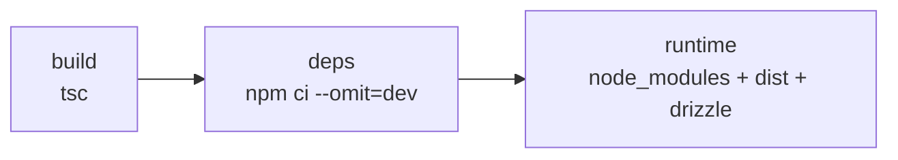
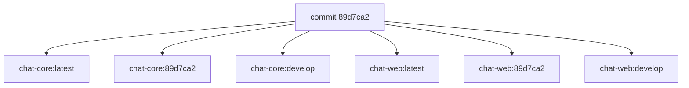

# Publicação

Como o código vira imagem no registry da PW2C.

## As imagens

| Dockerfile             | Imagem           | O que contém                     |
| ---------------------- | ---------------- | -------------------------------- |
| `Dockerfile.core`      | `chat-core`      | API Hono + migrations            |
| `Dockerfile.web`       | `chat-web`       | nginx servindo o bundle do Vite  |
| `Dockerfile.knowledge` | `chat-knowledge` | migrations do pacote `knowledge` |

### Dockerfile.core

Três etapas: `build` compila o TypeScript com o `devDependencies` inteiro; `deps`
instala só as dependências de produção; `runtime` junta as duas.



Roda como usuário `node` (não-root), expõe 3001, e tem `entrypoint.sh` como
entrada.

A pasta `drizzle/` vai para a imagem porque o `entrypoint.sh` aplica as
migrations no boot, antes do servidor HTTP subir. Ver
[deploy.md](deploy.md).

### Dockerfile.web

Duas etapas: build do Vite, depois nginx com os arquivos estáticos. O nginx
também faz proxy de `/api` para o Core.

`VITE_CORE_URL` é **argumento de build**, não variável de runtime: o Vite
embute o valor no bundle durante a compilação.

## O registry

`registry.cloud.grupopw2c.com.br`, o registry privado da empresa. As imagens são
privadas: estar na rede não basta, é preciso credencial.

### Autenticação no workflow

O token vem do GitHub, nos secrets `PW2C_REGISTRY_USERNAME` e
`PW2C_REGISTRY_PASSWORD`. Diferente do `ghcr.io`, onde o `GITHUB_TOKEN` bastava —
um registry externo exige credencial que alguém precise criar.

### Autenticação no cluster

O cluster precisa da mesma credencial para o `pull`. Ver
[pre-requisitos.md](pre-requisitos.md).

## As tags



Cada build publica três tags: `latest`, o sha completo, e o nome da branch.

**A tag de branch é a que o deploy aplica.** O `cd.yml` escreve
`OMNIA_CORE_IMAGE` e `OMNIA_WEB_IMAGE` no `.Env` da stack com
`chat-core:<branch>`, e o `RepullImageAndRedeploy` faz o Swarm buscar essa tag de
novo no registry.

**A tag de commit é a via de reverter.** Apontar as duas variáveis no `.Env` para o
sha de um deploy anterior, e atualizar a stack.

`latest` existe para inspeção, mas **não é o que o deploy aplica** — um ponteiro
que se move não permite voltar.

### Cada imagem publica só no seu repositório

Cada `build-push-action` recebe **tags explícitas**, uma linha por imagem:

```yaml
- name: Build and Push Core
  with:
    file: apps/docker/Dockerfile.core
    tags: |
      registry.cloud.grupopw2c.com.br/chat-core:latest
      registry.cloud.grupopw2c.com.br/chat-core:${{ github.sha }}
      registry.cloud.grupopw2c.com.br/chat-core:${{ github.ref_name }}

- name: Build and Push Web
  with:
    file: apps/docker/Dockerfile.web
    tags: |
      registry.cloud.grupopw2c.com.br/chat-web:latest
      registry.cloud.grupopw2c.com.br/chat-web:${{ github.sha }}
      registry.cloud.grupopw2c.com.br/chat-web:${{ github.ref_name }}
```

Se as duas imagens fossem configuradas num único gerador de tags, essa lista
serviria para os dois builds — e cada um publicaria nas duas. O último push
sobrescreve o outro, e `chat-core` passaria a conter a imagem da interface.

Como conferir: as duas tags de um mesmo build precisam ter **IDs de imagem
diferentes**.

## `platforms: linux/amd64`

O cluster é amd64. Fixar a plataforma evita que o build produza uma imagem que o
cluster não roda — o erro apareceria só no deploy, como
`no matching manifest for linux/amd64`.

`provenance: false` e `sbom: false` reduzem o que vai junto no registry. Se a
empresa quiser attestation e SBOM, é só remover as duas linhas.

## O cache

```yaml
cache-from: type=gha
cache-to: type=gha,mode=max
```

O `mode=max` guarda as layers intermediárias, o que deixa o build seguinte bem
mais rápido. Vale mais ainda por causa do `npm ci`: sem cache, cada build
reinstala todas as dependências.

## Verificar o que foi publicado

Na aba **Actions**, o passo **Resumo** mostra a branch e o commit. E no registry
da empresa, as duas imagens com tamanhos diferentes — o Core bem maior, por causa
do Node e do Drizzle.

## Documentos relacionados

| Documento                  | Assunto                           |
| -------------------------- | --------------------------------- |
| [deploy.md](deploy.md)     | o que acontece depois de publicar |
| [operacao.md](operacao.md) | diagnosticar falhas de publicação |
