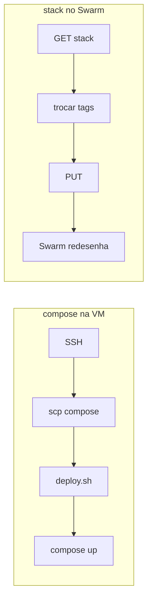

# Mudança por mudança

Cada alteração do modelo antigo para o novo, com o antes, o depois e o motivo.

## 1. O registry

|       |                                             |
| ----- | ------------------------------------------- |
| Antes | `ghcr.io/healthdevio/chat-core`             |
| Agora | `registry.cloud.grupopw2c.com.br/chat-core` |

O `ghcr.io` herdava a visibilidade do repositório e usava o `GITHUB_TOKEN`
automático. Um registry externo exige credencial criada à mão: `PW2C_REGISTRY_USERNAME`
e `PW2C_REGISTRY_PASSWORD`.

O `deploy-pw2c.yml` também perdeu o `permissions: packages: write` — só é
necessário para o GitHub Packages.

## 2. A entrada do deploy

|       |                                               |
| ----- | --------------------------------------------- |
| Antes | `appleboy/scp-action` + `appleboy/ssh-action` |
| Agora | `GET` + `PUT` na API do Portainer             |

**Antes:** o workflow abria SSH, enviava o compose e o `deploy.sh` por `scp`, e
o script rodava `docker compose pull` e `up -d` na máquina.

**Agora:** o workflow lê o estado da stack pela API, troca as tags das imagens no
`.Env`, e manda o compose e o `.Env` inteiros de volta. O Portainer aplica, e o
Swarm redesenha as tasks.



Três consequências da troca:

**Não precisa mais de chave SSH.** Nenhum secret de host, usuário ou chave
privada.

**O compose não é mais enviado a cada deploy.** Ele mora no Portainer, e o
workflow o reenvia com o que mudou. No modelo antigo, enviar a cada deploy era
uma escolha: uma cópia parada na VM divergiria do código, e o primeiro sintoma
seria um deploy executando configuração velha.

**A senha do banco não precisa mais ser gravada na máquina.** Ela vive no `.Env`
da stack.

## 3. O Postgres

|        | Antes                    | Agora                    |
| ------ | ------------------------ | ------------------------ |
| Onde   | container à parte        | serviço da stack         |
| Imagem | fora do repositório      | `pgvector/pgvector:pg16` |
| Rede   | `omnia-db`, criada à mão | `omnia_net` overlay      |
| Nome   | alias `--alias postgres` | nome do serviço          |

**Antes:** o banco era gerenciado pelo Portainer numa rede externa, e o compose
do deploy só o alcançava. Subir um `postgres` naquele compose criaria um banco
novo e vazio, com volume separado, e o Core passaria a falar com ele em vez do
real.

**Agora:** a stack é dona do banco. O Swarm resolve `postgres` pelo DNS da rede
overlay, e o problema `getaddrinfo ENOTFOUND postgres` deixa de existir.

### A fixidez

O modelo antigo não precisava de nada: uma VM, um lugar.

Com vários servidores, o Swarm distribuiria o container do Postgres por
qualquer nó — e o volume, que é local, não acompanha:

```
compute01   volume com os dados
compute02   container novo → banco VAZIO
```

A constraint trava o banco:

```yaml
placement:
  constraints:
    - node.hostname == compute01
```

Ver [decisoes.md](../decisoes.md#o-postgres-preso-ao-compute01) para o sintoma
enganoso que isso previne.

## 4. A migration

|              | Antes                            | Agora                      |
| ------------ | -------------------------------- | -------------------------- |
| Onde         | serviço `migrate-core`           | dentro do `entrypoint.sh`  |
| Como termina | `restart: 'no'` e sai            | não termina; o Core assume |
| Quem espera  | `service_completed_successfully` | o próprio script           |

O modelo antigo dependia de duas coisas que o Swarm não tem: container que
termina, e `depends_on` que funciona. Ver [decisoes.md](../decisoes.md#a-migration-dentro-do-core).

O `entrypoint.sh` faz três coisas em ordem:

```
espera o Postgres responder → node dist/db/migrate.js → exec node dist/index.js
```

## 5. As senhas

|        | Antes                               | Agora                         |
| ------ | ----------------------------------- | ----------------------------- |
| Banco  | `POSTGRES_PASSWORD` no `.env` da VM | `POSTGRES_PASSWORD` no `.Env` |
| Nvidia | `NVIDIA_API_KEY` no `.env`          | `NVIDIA_API_KEY` no `.Env`    |

Antes, o `deploy.sh` reescrevia só as linhas `IMAGE_*` no `.env` e deixava o
resto intacto.

Agora não há arquivo para reescrever: o `.Env` da stack é editado pela interface
do Portainer, e o workflow troca só as duas tags.

A diferença que mais importa: o `:?` no stack.

```yaml
POSTGRES_PASSWORD: ${POSTGRES_PASSWORD:?defina POSTGRES_PASSWORD no .Env da stack}
```

Sem a variável, o Swarm **recusa a stack** com mensagem explícita. Antes, uma
senha errada produzia um banco que aceitava a si mesmo e um Core que não
conseguia entrar — o sintoma mais difícil de diagnosticar do modelo antigo.

## 6. O gatilho

|           | Antes                       | Agora         |
| --------- | --------------------------- | ------------- |
| Dispara   | `workflow_run` depois da CI | `push` direto |
| Branches  | `develop` e `main`          | `main`        |
| Ambientes | `homolog` e `production`    | nenhum        |

A empresa pediu o modelo de `push`. Isso significa que o deploy **não espera a
CI** — confia que a branch só recebe código que passou.

Se isso for um problema, o `workflow_run` do modelo antigo resolve: o `cd.yml`
usava `workflow_run` com o nome exato do workflow da CI, e o mesmo cabe aqui.

Os GitHub Environments também saíram. A proteção de produção passa a ser o merge
do PR.

## 7. O healthcheck

|          | Antes                                     | Agora          |
| -------- | ----------------------------------------- | -------------- |
| Core     | healthcheck no compose, `service_healthy` | só o da imagem |
| Postgres | serviço `db` com `pg_isready`             | nenhum         |

A seção `healthcheck:` do compose é redundante no Swarm: quem manda é o
`HEALTHCHECK` da imagem. Manter os dois exigiria duplicar a mesma verificação em
dois lugares.

O serviço `db` — que só esperava o Postgres e saía — deixou de existir junto com
o `depends_on` que dependia dele. A espera ficou no `entrypoint.sh`.

## 8. O que sobrou do modelo antigo

O compose de **desenvolvimento** continua igual:

```text
apps/docker/docker-compose.yml   Postgres local + migrations do knowledge
apps/docker/Dockerfile           migrations do pacote knowledge
apps/docker/init.sql             CREATE EXTENSION vector
```

Ele roda o Postgres na máquina do desenvolvedor e não tem relação com o deploy.

O `deploy.sh` e o `docker-compose.deploy.yml` foram removidos — existiam só para
a VM.

## Documentos relacionados

| Documento                     | Assunto                             |
| ----------------------------- | ----------------------------------- |
| [README.md](README.md)        | o essencial da troca                |
| [decisoes.md](../decisoes.md) | por que cada chose assim            |
| [../deploy.md](../deploy.md)  | o processo de deploy no modelo novo |
