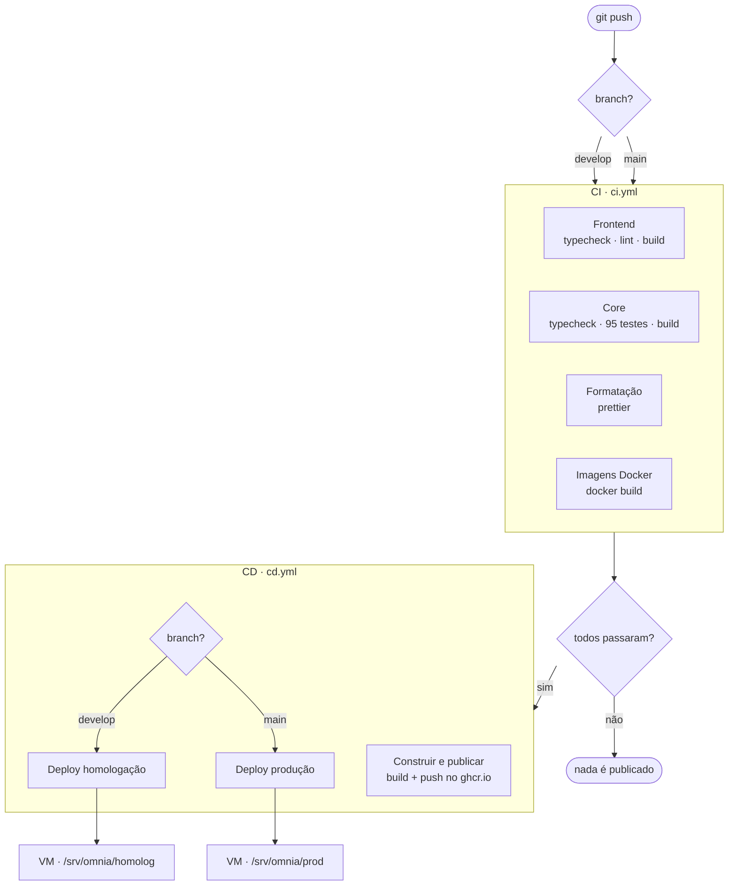
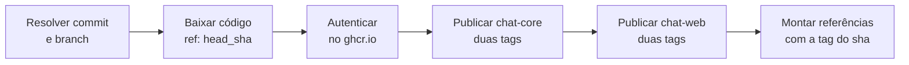
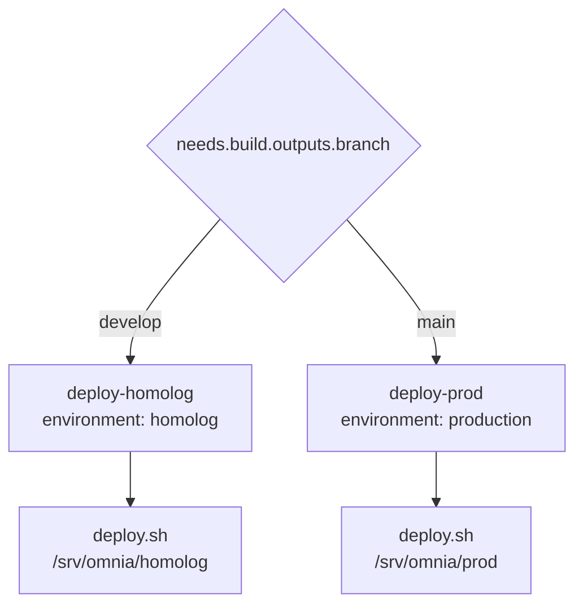
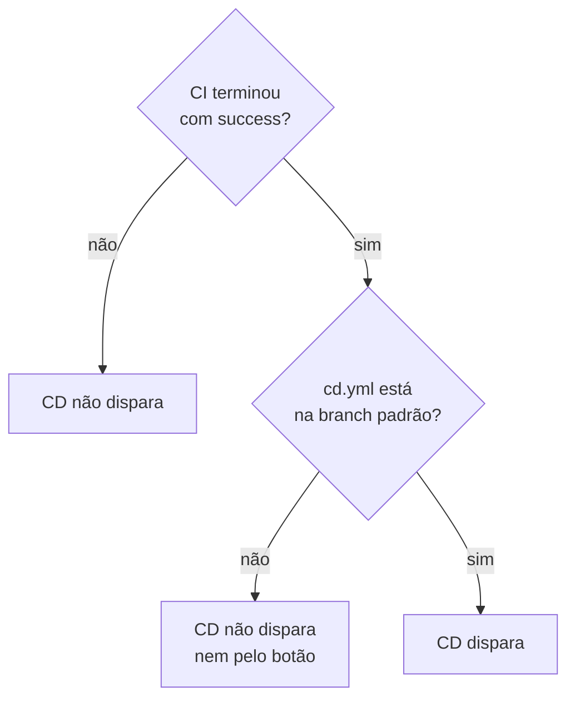

# Visão geral

O caminho completo de um `git push` até a aplicação no ar.



**O portão do `D`** é o que garante que o código publicado é o código testado.
Se qualquer um dos quatro jobs da CI falhar, o CD não roda: nada é publicado e
nada é implantado.

## Os quatro jobs da CI

Rodam **em paralelo**. Num job único, uma falha de formatação esconderia o
resultado da interface.

| Job            | O que protege                                     |
| -------------- | ------------------------------------------------- |
| Frontend       | tipos e lint de `apps/chat-omnia`                 |
| Core           | tipos, os 95 testes e o build de `apps/chat-core` |
| Formatação     | consistência de estilo do repositório inteiro     |
| Imagens Docker | os Dockerfiles constroem                          |

O job **Imagens Docker** constrói as imagens mas não as executa. Um container que
nunca subiu não é testado por ele — essa verificação acontece no deploy.

## A etapa de publicação



O passo `Resolver commit` normaliza os dois gatilhos possíveis:

| Gatilho             | De onde vem o commit                 |
| ------------------- | ------------------------------------ |
| `workflow_run`      | `github.event.workflow_run.head_sha` |
| `workflow_dispatch` | `github.sha`                         |

Sem essa normalização, o disparo manual cairia na branch errada — sem erro no log,
apenas a imagem errada.

### As tags

Cada imagem recebe duas:

```
ghcr.io/healthdevio/chat-core:89d7ca2    ← o deploy usa esta
ghcr.io/healthdevio/chat-core:develop     ← só inspeção
```

A tag do commit existe porque `latest` é um ponteiro que se move: sem número de
versão não há como reverter um deploy errado.

## A decisão do destino



Dois filtros protegem produção: o `if:` do job e o GitHub Environment
`production`, configurado para aceitar apenas `main`. Se algo escapar do
primeiro, o segundo barra.

## Os dois gatilhos

| Gatilho             | Quando dispara                                   | Para quê                        |
| ------------------- | ------------------------------------------------ | ------------------------------- |
| `workflow_run`      | CI termina com `success`, em `develop` ou `main` | o caminho normal                |
| `workflow_dispatch` | pelo botão "Run workflow" na aba Actions         | repetir um deploy sem novo push |

O manual existe porque `workflow_run` só enxerga workflows na branch padrão. No
intervalo entre o `cd.yml` entrar na `develop` e chegar na `main`, o automático
não dispara — e a falha é silenciosa.

## Quando o CD não roda



O segundo caso é a pegadinha mais cara do desenho: sem erro, sem aviso, o CD
simplesmente não acontece.

## Documentos relacionados

| Documento                              | Assunto                           |
| -------------------------------------- | --------------------------------- |
| [pre-requisitos.md](pre-requisitos.md) | o que precisa existir antes       |
| [publicacao.md](publicacao.md)         | build e publicação em detalhe     |
| [deploy.md](deploy.md)                 | o que acontece na VM              |
| [operacao.md](operacao.md)             | verificar, diagnosticar, reverter |
