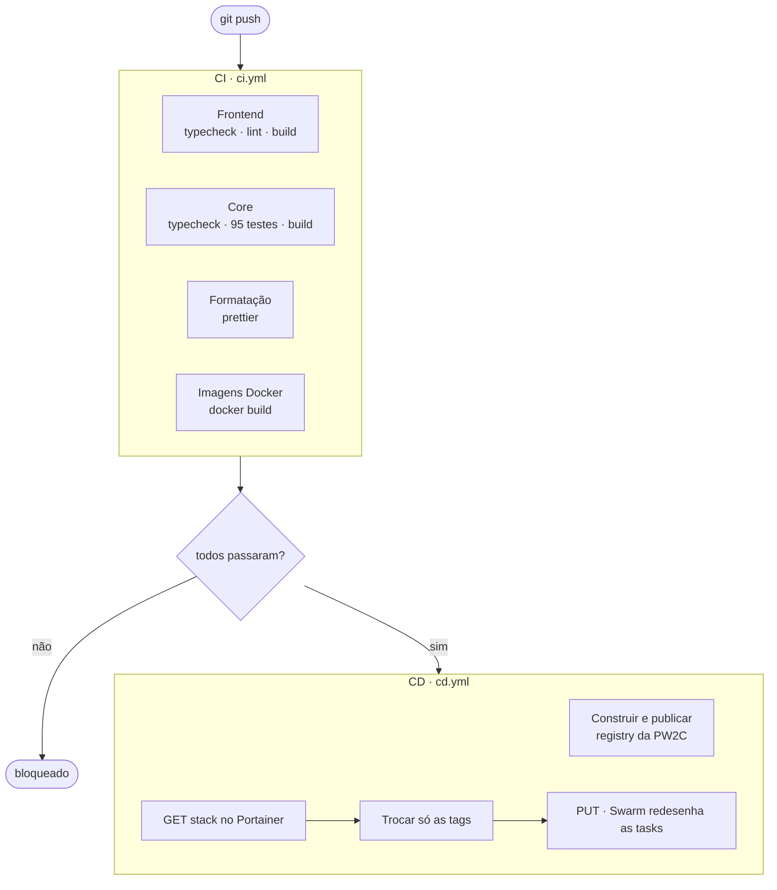
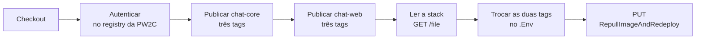
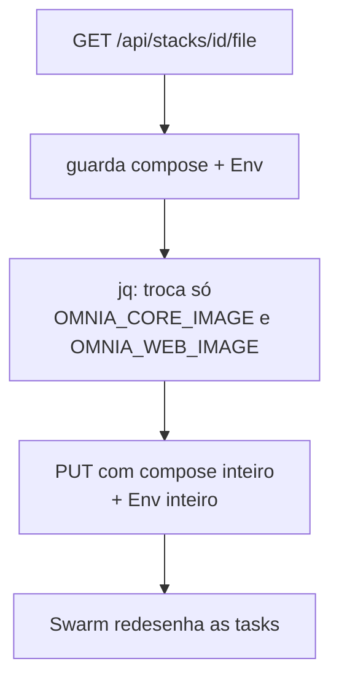

# Visão geral

O caminho completo de um `git push` até a aplicação no ar.



**O portão do `D`** garante que o código publicado é o código testado. Se
qualquer um dos quatro jobs da CI falhar, o CD não roda.

O `cd.yml` dispara direto em `push`, sem esperar a CI. É uma escolha
diferente do modelo anterior: lá o `workflow_run` segurava a publicação até a CI
passar. Aqui o deploy confia que a branch só recebe código que passou.

Se isso for um problema — alguém com acesso de escrita direto na `main` —, o
`workflow_run` resolve. Mas a empresa pediu o modelo de `push`.

## Os quatro jobs da CI

Rodam **em paralelo**. Num job único, uma falha de formatação esconderia o
resultado da interface.

| Job            | O que protege                                     |
| -------------- | ------------------------------------------------- |
| Frontend       | tipos e lint de `apps/chat-omnia`                 |
| Core           | tipos, os 95 testes e o build de `apps/chat-core` |
| Formatação     | consistência de estilo do repositório inteiro     |
| Imagens Docker | os Dockerfiles constroem                          |

O job **Imagens Docker** constrói as imagens mas não as executa. Um container que
nunca subiu não é testado por ele — essa verificação acontece no deploy.

## A publicação



### As três tags

```
registry.../chat-core:latest      ← inspeção
registry.../chat-core:<sha>       ← reversão
registry.../chat-core:<branch>    ← o que o deploy aplica
```

O deploy escreve a tag da branch no `.Env` da stack. A tag do sha é a via de
voltar.

## A atualização da stack



Três detalhes que fazem esse passo funcionar:

**O `PUT` substitui.** Sem `StackFileContent` no corpo, o Swarm entende que a
stack ficou sem serviços e remove tudo.

**O `Env` vai inteiro.** A senha do Postgres e a chave da Nvidia vivem lá, não no
compose. Mandar só as duas tags deixaria o banco subir sem senha.

**O compose é reenviado.** Por isso o `GET` antes: o deploy mexe só no que muda e
devolve o resto igual.

Ver [deploy.md](deploy.md) para o detalhe.

## Por que a API e não um webhook

O Portainer é **Community Edition**, e webhook de stack é Business Edition. Na CE
o botão não aparece na tela, e `POST /api/stacks/webhooks/{id}` devolve 404.

A API existe nas duas edições. O custo é precisar de quatro secrets em vez de um:
`PORTAINER_URL`, `PORTAINER_API_KEY`, `PORTAINER_STACK_ID` e
`PORTAINER_ENDPOINT_ID`.

## Documentos relacionados

| Documento                              | Assunto                           |
| -------------------------------------- | --------------------------------- |
| [pre-requisitos.md](pre-requisitos.md) | o que precisa existir antes       |
| [publicacao.md](publicacao.md)         | build e publicação em detalhe     |
| [deploy.md](deploy.md)                 | o que acontece no cluster         |
| [operacao.md](operacao.md)             | verificar, diagnosticar, reverter |
